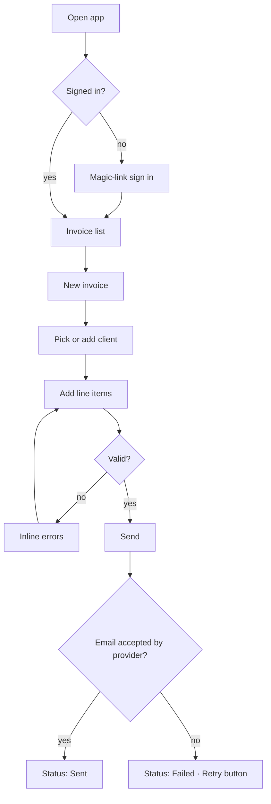
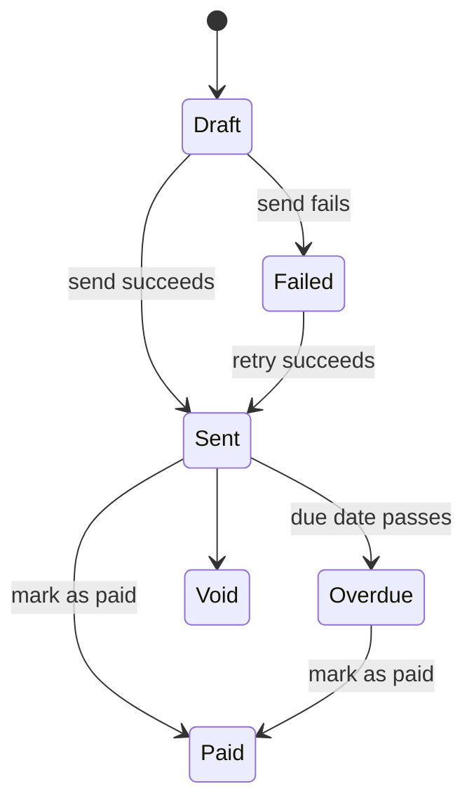
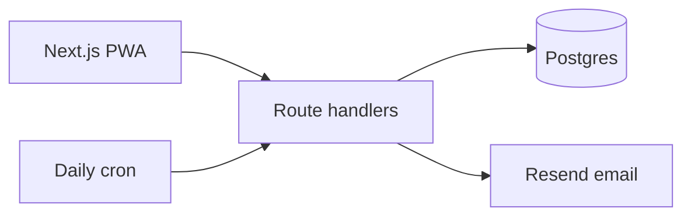
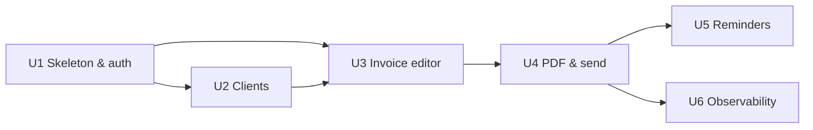

# QuickBill — PRD

| Field | Value |
|-------|-------|
| Status | Approved |
| Version | 1.0 |
| Owner | Sam (solo founder) |
| Last updated | 2026-11-17 |
| Product form | Web app (mobile-first, installable PWA) |

## 1. Summary
- **Positioning:** A mobile-first web app for solo freelancers that turns "what did I do for this client" into a sent, trackable invoice in under two minutes. Unlike spreadsheet templates or full accounting suites, it does one job: send and chase invoices.
- **Problem:** Freelancers invoice late because building an invoice in a Google Doc is tedious, and they lose money because nobody reminds the client when it is overdue.
- **MVP goal:** Prove freelancers will send their real invoices through QuickBill at least twice a month.

## 2. Users & Scenarios
### Personas
| Persona | Who | Core pain | Today's workaround | Tech comfort |
|---------|-----|-----------|--------------------|--------------|
| Maya, designer | Solo, 4–8 clients, invoices monthly | Forgets to chase late payments | Google Docs template + calendar reminders | Medium |
| Leo, developer | Contractor, 1–2 clients, invoices weekly | Re-typing the same line items | Spreadsheet → PDF export | High |

### Scenarios
1. Maya finishes a logo project on her phone at a café, opens QuickBill, picks the client, adds "Logo design — $1,200", taps Send. The client gets an email with a pay link.
2. Leo duplicates last week's invoice, changes hours from 32 to 36, sends.
3. An invoice passes its due date. QuickBill emails the client a polite reminder and Maya sees "Overdue · reminder sent" on her list.

## 3. Goals, Non-Goals & Metrics
### Goals
- Create and send an invoice in under 2 minutes on mobile.
- Automatic overdue reminders without the user lifting a finger.
### Non-goals
- Expense tracking, taxes, or bookkeeping — accounting suites own this; scope creep kills the 2-minute promise.
- Multi-user teams — solo freelancers are the wedge.
### Success metrics
| Metric | Target | How measured |
|--------|--------|--------------|
| Time to first sent invoice | Median < 5 min from sign-up | `invoice_sent` minus `signup` event |
| Active senders | 40% of sign-ups send ≥ 2 invoices in their first 30 days | Analytics cohort |
| Paid on time | 15-point lift vs. users' self-reported baseline | Survey + payment timestamps |

## 4. Scope
### Feature tree
```
QuickBill
├── P0 Invoices
│   ├── Create / edit / duplicate invoice
│   └── Send by email with PDF + pay link
├── P0 Clients
│   └── Save client name, email, currency
├── P0 Reminders
│   └── Automatic overdue reminder emails
├── P1 Payments
│   └── Stripe card payments, auto-mark paid
└── P2 Insights
    └── Monthly revenue chart
```
### MVP in scope
- [ ] Create, edit, duplicate invoices
- [ ] Send invoice email with PDF
- [ ] Client list
- [ ] Overdue reminders
### Out of scope for MVP
- Stripe payments (P1) — manual "mark as paid" first to validate sending behavior.
- Revenue insights (P2).

## 5. User Flows
### Main flow


## 6. Key Screen Wireframe
Invoice editor (mobile):
```
┌─────────────────────────┐
│ ←  New invoice   [Save] │  top bar
├─────────────────────────┤
│ Client  [Acme Inc ▾]    │
│ Due     [Dec 1, 2026]   │
├─────────────────────────┤
│ Logo design    $1,200 ✕ │  line items  ← focus
│ + Add item              │
├─────────────────────────┤
│ Total          $1,200   │
├─────────────────────────┤
│ [      Send invoice   ] │  sticky primary action
└─────────────────────────┘
```

## 7. Feature Specs
### 7.1 Create & send invoice
**What & why:** The core loop. Build an invoice from client + line items and email it as a PDF.
**Trigger:** "New invoice" on the list, or "Duplicate" on an existing invoice.
**User stories**
- As a freelancer, I want to send an invoice from my phone, so that I bill the moment the work is done.
- As a freelancer, I want to duplicate last week's invoice, so that recurring work takes seconds.
**Acceptance criteria**
- [ ] Given a client and one line item, when I tap Send, then the client receives an email with a PDF within 60 seconds.
- [ ] Given a line item with an empty amount, when I tap Send, then Send is blocked and the field shows "Add an amount".
- [ ] Given a sent invoice, when I tap Duplicate, then a new draft opens with the same client and items and a new number.
**Edge cases & interaction details**
| Situation | Behavior |
|-----------|----------|
| Empty state (no invoices) | Illustration + "Send your first invoice" button |
| Loading | Skeleton rows on list; Send button shows spinner and is disabled |
| Email provider error | Status "Failed", toast "Couldn't send. Try again." with Retry |
| Signed out mid-edit | Draft kept in local storage; restored after sign-in |
| Amount > $1,000,000 or negative | Inline error "Enter an amount between $0.01 and $999,999.99" |
| Double tap on Send | Button disabled after first tap; server dedupes by idempotency key |
| Delete a sent invoice | Not allowed; offer "Void" with confirmation |
**States**

**Data:** `Invoice`, `LineItem`, `Client` (section 8).
**Copy:** Button "Send invoice" · Success toast "Sent to {client_email}" · Email subject "Invoice {number} from {sender_name}".

### 7.2 Overdue reminders
**What & why:** Clients pay late because nobody nudges them. Automate the nudge.
**Trigger:** Daily job at 09:00 in the sender's time zone.
**User stories**
- As a freelancer, I want late clients reminded automatically, so that I don't have to send awkward emails.
**Acceptance criteria**
- [ ] Given an invoice 1 day past due, when the daily job runs, then one reminder is emailed and the status becomes Overdue.
- [ ] Given reminders already sent on days 1 and 7, when day 14 passes, then a final reminder is sent and no more after that.
- [ ] Given I toggle reminders off for an invoice, then no reminders are sent for it.
**Edge cases & interaction details**
| Situation | Behavior |
|-----------|----------|
| Client email bounces | Mark reminder "Bounced", notify sender in app |
| Invoice paid between job runs | Job re-checks status before sending |
| Job runs twice | Unique (invoice_id, reminder_day) prevents duplicates |
**Copy:** Tone friendly, never threatening. Subject "Friendly reminder: invoice {number} was due {due_date}".

### 7.3 Clients
Short form: name (required), email (required, validated), currency (default USD). Shown as a picker in the editor with "+ New client" inline.

## 8. Data Model
### Entities
| Entity | Field | Type | Required | Default | Constraints |
|--------|-------|------|----------|---------|-------------|
| Client | id | uuid | yes | generated | |
| Client | email | text | yes | — | valid email, ≤ 254 chars |
| Client | currency | char(3) | yes | USD | ISO 4217 |
| Invoice | number | text | yes | next in sequence | unique per user |
| Invoice | status | enum | yes | draft | draft/sent/failed/overdue/paid/void |
| Invoice | due_date | date | yes | today + 14 | ≥ issue date |
| LineItem | amount_cents | int | yes | — | 1 … 99,999,999 |
| Reminder | reminder_day | int | yes | — | 1, 7, 14; unique with invoice_id |
### Relationships
User 1—n Client 1—n Invoice 1—n LineItem; Invoice 1—n Reminder.
### Retention & privacy
Invoices kept for 7 years (tax records). Account deletion removes clients and drafts and anonymizes sent invoices. [ASSUMPTION] 7 years covers the US and EU — because most jurisdictions require 5–7.

## 9. Architecture & Tech Stack
### Architecture

### Stack
| Layer | Choice | Version | Why |
|-------|--------|---------|-----|
| App | Next.js App Router | 16 | One codebase for UI + API |
| DB | Postgres (Neon) + Drizzle | latest | Relational data, cheap |
| Auth | Magic link (Auth.js) | 5 | No passwords for a 2-minute product |
| Email | Resend | latest | Simple API, delivery webhooks |
| PDF | @react-pdf/renderer | 4 | Server-side PDF from React |
### Project structure
```
app/            routes and pages
lib/db/         schema + queries
lib/email/      templates
lib/pdf/        invoice PDF component
```
### Patterns & conventions
Server actions for mutations; zod validation at every boundary; money in integer cents; Vitest + Playwright.
### Integrations
Resend — on failure set status Failed and surface Retry. No silent drops.

## 10. API Specification
`POST /api/invoices/:id/send` — auth required, header `Idempotency-Key`. 200 `{ status: "sent" }` · 422 validation errors · 502 `{ status: "failed" }` when the provider rejects.

## 11. Non-Functional Requirements
- **Performance:** Editor interactive < 2 s on 4G; send round-trip p95 < 3 s.
- **Security & auth:** Magic link expires in 15 min; row-level ownership checks on every query; no secrets client-side.
- **Configuration:** `DATABASE_URL` (required), `RESEND_API_KEY` (required), `APP_URL` (required), `CRON_SECRET` (required).
- **Accessibility:** WCAG 2.2 AA; all actions keyboard-reachable.
- **Observability:** Sentry for errors; events `signup`, `invoice_sent`, `reminder_sent`.
- **Copy & tone:** Friendly, plain, short. Never guilt the client.
- **Platforms / i18n:** Latest Safari, Chrome, Firefox; English only for MVP. [TBD] Which currencies to support beyond USD/EUR/GBP.

## 12. Implementation Plan (Work Units)
### Dependency graph

### U1 — Skeleton & auth
| depends_on | tier | risk | rollback |
|------------|------|------|----------|
| — | 3 | medium (auth) | revert unit commits; drop DB branch |
**Scope:** `app/`, `lib/db/schema.ts`, Auth.js config. No invoice logic.
**Acceptance tests**
- [x] Next.js app, Drizzle schema, and Neon DB connected
- [x] Magic-link sign-in works; link expires after 15 min
- [x] Signed-in user sees the empty-state invoice list
- [x] **U1 done**
### U2 — Clients
| depends_on | tier | risk | rollback |
|------------|------|------|----------|
| U1 | 1 | low | revert unit commits |
**Scope:** `app/clients/`, `lib/db/clients.ts`.
**Acceptance tests**
- [x] Create, edit, delete client with email validation
- [ ] Currency defaults to USD
- [ ] **U2 done**
### U3 — Invoice editor
| depends_on | tier | risk | rollback |
|------------|------|------|----------|
| U1, U2 | 2 | medium | revert unit commits |
**Scope:** `app/invoices/`, `lib/db/invoices.ts`. No sending.
**Acceptance tests**
- [ ] 7.1: empty amount blocks Send with "Add an amount"
- [ ] 7.1: Duplicate opens a new draft with a new number
- [ ] Draft survives sign-out (local storage restore)
- [ ] **U3 done**
### U4 — PDF & send
| depends_on | tier | risk | rollback |
|------------|------|------|----------|
| U3 | 2 | medium (email) | feature-flag Send off |
**Scope:** `lib/pdf/`, `lib/email/`, `POST /api/invoices/:id/send`.
**Acceptance tests**
- [ ] 7.1: test invoice reaches a real inbox within 60 s
- [ ] Double submit sends once (idempotency key)
- [ ] Provider error sets Failed and shows Retry
- [ ] **U4 done**
### U5 — Overdue reminders
| depends_on | tier | risk | rollback |
|------------|------|------|----------|
| U4 | 2 | medium | disable cron |
**Scope:** cron route, `lib/reminders.ts`, bounce webhook.
**Acceptance tests**
- [ ] 7.2: reminders on days 1, 7, 14 only, never duplicated
- [ ] 7.2: per-invoice toggle stops reminders
- [ ] Bounced email surfaces in app
- [ ] **U5 done**
### U6 — Observability
| depends_on | tier | risk | rollback |
|------------|------|------|----------|
| U4 | 1 | low | revert unit commits |
**Scope:** Sentry setup, analytics events.
**Acceptance tests**
- [ ] `signup`, `invoice_sent`, `reminder_sent` events fire
- [ ] Errors reach Sentry with user id, no PII in payload
- [ ] **U6 done**
### Final verification
- [ ] All section 7 acceptance criteria pass end to end on staging
- [ ] Build, tests, lint green on a clean checkout

## 13. Risks & Mitigations
| Risk | Likelihood | Impact | Mitigation |
|------|-----------|--------|------------|
| Reminder emails land in spam | Medium | High | SPF/DKIM on a dedicated domain; plain-text alternative |
| Users want card payments on day one | Medium | Medium | Ship P1 Stripe right after MVP; collect interest via a "Pay by card?" toggle |
| PDF rendering is slow on serverless | Low | Medium | Cache PDF per invoice version |

## 14. Assumptions & Open Questions
### Assumptions
- [ASSUMPTION] Freelancers accept magic-link sign-in — because the target users already use Slack/Notion magic links.
### Open questions
- [TBD] Pricing: free tier limit (3 invoices/month?) — Sam, before launch.
- [TBD] Custom invoice branding (logo) in MVP or P1 — Sam, before Phase 3.

## 15. Build Handoff (for Claude Code)
```markdown
## Product requirements
- Source of truth: `PRD.md`. Read the relevant section before changing behavior.
- Build work units from section 12 in dependency order. Tick a box in PRD.md only after verifying it; tick `**Ux done**` last.
- After each unit, append one line to section 16 (Execution Log).
- Never implement out-of-scope items (section 4) or resolve a [TBD] by guessing — ask.
- Stack and conventions: section 9. Data shapes: section 8. Copy: section 7 + 11.
```

## 16. Execution Log
| When | Unit | Result | Notes |
|------|------|--------|-------|
| 2026-11-17 10:02 | U1 | ✅ done | 3/3 tests green |
| 2026-11-17 10:41 | U2 | ⏳ in progress | email validation merged |
