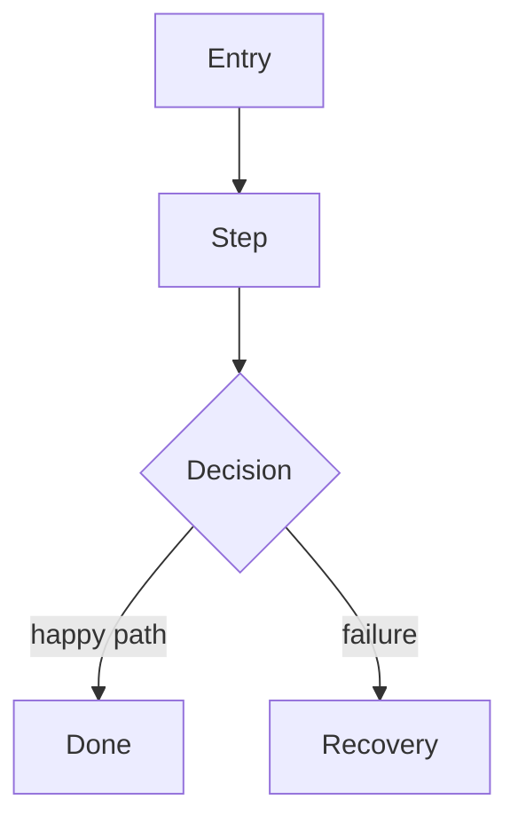
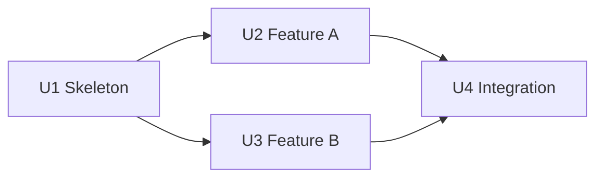

# PRD Template

Follow this structure. Keep headings as written (the tracker builds its table of contents and progress from `##` and `###` headings). Skip a section only if it truly does not apply, and say so in one line. Use `[TBD]` for unknowns and `[ASSUMPTION]` for reasoned guesses.

---

~~~~markdown
# <Product Name> — PRD

| Field | Value |
|-------|-------|
| Status | Draft / In review / Approved |
| Version | 0.1 |
| Owner | … |
| Last updated | YYYY-MM-DD |
| Product form | Web app / PWA / Native / CLI / Plugin … |

## 1. Summary
- **Positioning:** A <form> for <user> that helps them <outcome>. Unlike <alternative>, it <difference>.
- **Problem:** 2–3 sentences, in the user's words where possible.
- **MVP goal:** the one thing the first release must prove.

## 2. Users & Scenarios
### Personas
| Persona | Who | Core pain | Today's workaround | Tech comfort |
### Scenarios
2–3 concrete scenarios: who, in what situation, does what, expects what result.

## 3. Goals, Non-Goals & Metrics
### Goals
### Non-goals
Explicitly out, with the reason.
### Success metrics
| Metric | Target | How measured |
Each metric is a number with a time window ("70% of new users finish onboarding in week 1").

## 4. Scope
### Feature tree
Priority tags: **P0** = MVP must-have · **P1** = next iteration · **P2** = future.
```
Product
├── P0 Module A
│   ├── Feature 1
│   └── Feature 2
├── P1 Module B
└── P2 Module C
```
### MVP in scope
- [ ] … (one line per P0 feature)
### Out of scope for MVP
- … (P1/P2 items, with why)

## 5. User Flows
### Main flow

Cover the main path plus at least two failure branches (error, no permission, empty data, offline).

## 6. Key Screen Wireframe
ASCII wireframe of the single most important screen: navigation position, regions, visual focus, overlays (modals, drawers). One screen is enough.

## 7. Feature Specs
One `###` per P0 feature. Never merge two P0 features. P1 features may get a short paragraph.

### 7.x <Feature name>
**What & why:** the problem it solves and its core logic.
**Trigger:** when and how the user enters it.
**User stories**
- As a <user>, I want to <action>, so that <benefit>.
**Acceptance criteria**
- [ ] Given <context>, when <action>, then <observable result>.
**Edge cases & interaction details**
| Situation | Behavior |
|-----------|----------|
| Empty state | … guidance + call to action |
| Loading | … |
| Error / network failure | … message + retry |
| No permission / signed out | … |
| Invalid / overlong input | … limit + message |
| Double submit / concurrency | … |
| Destructive action | … confirmation |
**States** — table or `stateDiagram-v2` for anything with a lifecycle (draft → published → archived).
**Data** — fields this feature reads/writes (link to section 8).
**Copy** — user-facing strings for buttons, empty states, errors. Tone: <define once in 11>.

## 8. Data Model
### Entities
| Entity | Field | Type | Required | Default | Constraints |
### Relationships
Short list or `erDiagram`.
### Retention & privacy
What is stored, for how long, who can see it.

## 9. Architecture & Tech Stack
### Architecture
Mermaid diagram of components and data flow.
### Stack
| Layer | Choice | Version | Why |
### Project structure
```
src/
  …
```
### Patterns & conventions
Naming, state management, error handling, testing approach.
### Integrations
Third-party services, what they do, failure fallback.

## 10. API Specification
Per endpoint: method + path, auth, request, response, errors, example payload. Skip with one line if no API.

## 11. Non-Functional Requirements
- **Performance:** concrete budgets (p95 latency, page weight).
- **Security & auth:** auth method, roles, secrets handling, threat notes.
- **Configuration:** env vars table (`NAME` · purpose · required · example).
- **Accessibility:** WCAG target, keyboard, contrast.
- **Observability:** logging, error tracking, analytics events.
- **Copy & tone:** voice for end-user text (e.g. "friendly, plain, no jargon").
- **Platforms / i18n:** browsers, devices, languages.

## 12. Implementation Plan (Work Units)
Break the build into a DAG of work units (ralphinho RFC pipeline). Each unit is independently verifiable and fits one agent session or one loop iteration. 4–12 units for an MVP.
### Dependency graph

### U1 — <name>
| depends_on | tier | risk | rollback |
|------------|------|------|----------|
| — | 1 | low | revert the unit's commits |
**Scope:** files/areas this unit may touch, and what it must not touch.
**Acceptance tests**
- [ ] <observable, testable check — reference 7.x criteria where they apply>
- [ ] Tests for this unit pass; lint and typecheck clean
- [ ] **U1 done**
### U2 — <name>
…

Tiers: **1** isolated edits, deterministic tests · **2** multi-file behavior, moderate integration risk · **3** schema, auth, performance, or security.
Rules: tick an acceptance box only after verifying it. Tick `**Ux done**` last, after every box in the unit is ticked and integration tests still pass. Never start a unit whose `depends_on` units are not done.
### Final verification
- [ ] All section 7 acceptance criteria pass end to end
- [ ] Success-metric events from section 3 fire
- [ ] Build, tests, lint green on a clean checkout

## 13. Risks & Mitigations
| Risk | Likelihood | Impact | Mitigation |

## 14. Assumptions & Open Questions
### Assumptions
- [ASSUMPTION] … — because …
### Open questions
- [TBD] … — owner, needed by

## 15. Build Handoff (for Claude Code)
Copy this block into the project's `CLAUDE.md`.
```markdown
## Product requirements
- Source of truth: `PRD.md`. Read the relevant section before changing behavior.
- Build work units from section 12 in dependency order. Tick a box in PRD.md only after verifying it; tick `**Ux done**` last.
- After each unit, append one line to section 16 (Execution Log).
- Never implement out-of-scope items (section 4) or resolve a [TBD] by guessing — ask.
- Stack and conventions: section 9. Data shapes: section 8. Copy: section 7 + 11.
```

## 16. Execution Log
Appended by the build agent, newest last. One line per unit attempt.
| When | Unit | Result | Notes |
|------|------|--------|-------|
~~~~
